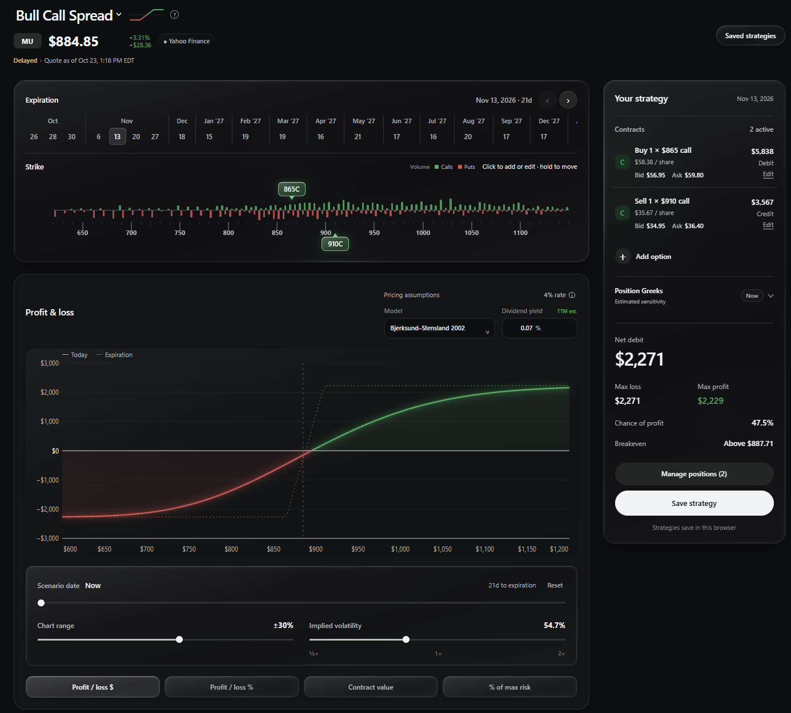

# Options Visualizer

Build options strategies visually and view estimated profit and loss across price, time, and implied volatility.

## Features

- Browse call and put chains with volume and bid/ask quotes
- Add contracts, edit them from the strike chart, or hold and drag to move them
- Explore profit and loss by stock price, scenario date, and implied volatility
- View Greeks, breakeven, risk, reward, and estimated probability of profit
- Choose Bjerksund–Stensland 2002 or Black–Scholes pricing
- Save strategies in your browser

## Install on Windows

1. Download and extract the project ZIP from GitHub.
2. Run **Install Dependencies.bat** to install Node.js and Python if needed, prepare the local Python environment, and install yfinance.
3. Run **Open Options Visualizer.bat** to start the app.

Dependency installation needs an internet connection and may ask you to approve installs. If `winget` is unavailable, install Node.js and Python from the official pages it opens, then run **Install Dependencies.bat** again.

To use it later, run **Open Options Visualizer.bat**.

## Requirements

- Windows 10 or newer, 64-bit
- A current web browser
- Internet access for setup and Yahoo Finance data

## Data and estimates

Quotes and option chains use Yahoo Finance through yfinance and may be delayed, unavailable, or rate-limited. Profit/loss and Greeks are estimates based on the selected pricing model and assumptions.

## For developers

Requires Node.js 20.11+ and Python 3.10+. Install Python dependencies with `py -3 -m pip install -r requirements.txt`, then start with `node server.mjs` and open <http://127.0.0.1:5173>.

Run tests with `node --test` and `py -3 tests/yfinance_worker_test.py`.

## License

MIT. See [LICENSE](LICENSE).

